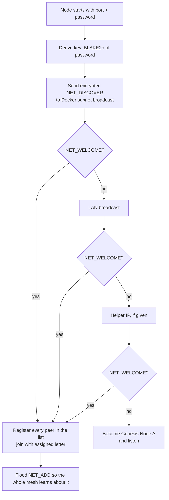
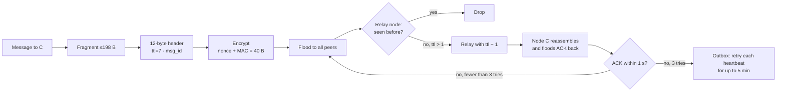
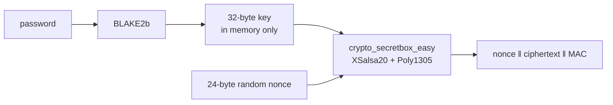

<div align="center">

# OMEN

**Offline Mesh Emergency Network**

*Encrypted peer-to-peer messaging between laptops on a shared Wi-Fi or hotspot, with no router, internet or server*

Written in C · UDP · POSIX threads · libsodium

[How it works](#architecture) · [Build](#installation) · [Run](#running) · [Limitations](#known-limitations)

<!-- Screenshot placeholder: add docs/images/omen-two-nodes.png (two terminals chatting) and uncomment

-->

</div>

---

## Overview

When a flood or a blackout takes out mobile towers and broadband, the laptops and phones in a building still have
Wi-Fi radios, and a single phone hotspot is enough to put them on one network. What's missing is software that lets
them talk to each other without a server somewhere to route through.

OMEN is that software. Start it on each machine with the same password. The nodes find each other, agree on letter
names (A, B, C…), and can send direct messages or broadcast to everyone. Every packet is encrypted, including the
discovery packets, so a node without the password can't even see that the mesh exists. Messages hop through other
nodes to reach ones that are out of direct range. A message to a node that's offline is held and delivered when it
comes back.

For each message, OMEN:

1. Splits it into fragments small enough for a ~250-byte radio frame.
2. Puts a 12-byte binary header on each fragment: version, hops left, fragment index and count, message ID.
3. Encrypts each fragment with XSalsa20-Poly1305 under a key derived from the shared password.
4. Floods it to every known peer. Each node relays a packet once, decrementing the hop count.
5. On a direct message, waits for an ACK and resends up to 3 times. If there's no ACK, queues it for later.
6. Reassembles the fragments at the destination and drops duplicates and replays it has already seen.

## Features

| Capability | Description |
|---|---|
| Auto-discovery | 3 layers: Docker subnet broadcast → LAN broadcast → a helper IP you pass in |
| Stable identity | Permanent random 8-byte node ID in `identity.dat`; the letter is bound to it, so a node keeps its letter across restarts and IP changes |
| Authenticated encryption | libsodium `crypto_secretbox` (XSalsa20-Poly1305); key = BLAKE2b hash of the password, held in memory only |
| Reliable direct messages | Stop-and-wait ARQ (RDT 3.0): alternating 0/1 sequence numbers, 1 s timeout, 3 attempts |
| Multi-hop relay | Controlled flooding with a TTL of 7; each node relays each packet once |
| Duplicate and replay drop | 256-entry ring of recently seen (message ID, fragment) pairs |
| Store-and-forward | Up to 32 queued messages for offline nodes, retried every heartbeat, dropped after 5 min |
| Fragmentation | ~198-byte payload per fragment, up to 16 fragments (~3 KB), 8 reassembly slots that expire after 30 s |
| Heartbeat and purge | Ping every 5 s; a node silent for 15 s is removed |
| Live topology | `NET_ADD` / `NET_WELCOME` / `NET_LEAVE`, flooded so distant nodes see the full mesh |
| Chat history | Every sent and received message saved to `chat_history_<Node>.txt` with timestamps |

---

## What makes it different

1. **No infrastructure at all.** No server, no router, no internet, no cloud relay. The first node to start becomes Node A, and every node after it joins through whoever answers.
2. **Even discovery is encrypted.** The `NET_DISCOVER` packet is encrypted like everything else. Nodes with the wrong password can't decrypt or answer it.
3. **Built for a radio link later.** The frame format, fragment size and fixed-size buffers are sized for a LoRa-style 250-byte frame and a microcontroller with no heap to spare. Everything above the send/receive layer doesn't care what the transport is.
4. **Memory never grows.** The dedup cache, reassembly table and outbox are all fixed-size, so a flood of packets or a lost fragment can't use up memory.

> **Decision:** relaying uses flooding instead of a routing table. Every node relays each packet once and the TTL caps
> how far it goes, so there's no route to compute or keep up to date while nodes join and drop. The dedup cache is
> what stops the flood from looping.

---

## Architecture

### Joining the mesh



Every node runs the full discovery sequence on startup, even if it has a saved `nodes.dat`. `NET_WELCOME` is the only
source of truth for who's in the mesh.

### Sending a direct message



### Packet layout

```
| 24 B nonce | ---------------- encrypted + 16 B Poly1305 MAC ---------------- |
             | ver | ttl | frag_idx | frag_cnt | 8 B msg_id | payload ≤198 B |
```

---

## Tech Stack

| Area | Technology |
|---|---|
| Language | C11 |
| Networking | UDP sockets (`SOCK_DGRAM`), `select()` over the data and discovery sockets |
| Concurrency | POSIX threads: receiver thread, heartbeat thread, mutexes on shared state, `_Atomic` flags |
| Cryptography | libsodium: `crypto_secretbox_easy`, `crypto_generichash`, `randombytes_buf` |
| Containers | Docker, Docker Compose (bridge network `10.10.0.0/24`) |
| Build and test | GNU Make, `make test` for the framing layer |

---

## Deep Dive: The Layers

### Layer 1: framing

Every packet starts with a fixed 12-byte header, before encryption:

| Byte | Field | Purpose |
|---|---|---|
| 0 | version | reject packets from a different protocol version |
| 1 | ttl | hops left; each relay decrements it |
| 2 | frag_index | which fragment this is (0-based) |
| 3 | frag_count | total fragments (1 = not fragmented) |
| 4-11 | msg_id | random ID shared by all fragments of one message |

A fixed binary header means a microcontroller can parse it without `sscanf`, and it spends as little of a 250-byte
frame as possible on framing. The payload per fragment is what's left:

$$\text{payload} = \underbrace{250}_{\text{MTU}} - \underbrace{12}_{\text{header}} - \underbrace{40}_{\text{nonce + MAC}} = 198 \text{ bytes}$$

> **Decision:** fragments are sized for a LoRa-style frame even though OMEN runs over UDP today. That way fragmentation
> and reassembly are actually used and tested now instead of being code written for later that nobody runs.

### Layer 2: encryption



No key file is ever written to disk. A tampered packet fails the MAC check and is dropped without a reply.

### Layer 3: reliable delivery (RDT 3.0)

Direct messages use stop-and-wait ARQ with alternating 0/1 sequence numbers. The sender floods `DIR:<to>:<seq>:<from>:<msg>`
and waits up to 1 s for `ACK:<from>:<seq>:<to>`. It tries 3 times in total. Only the destination consumes the
message and ACKs it. Every other node just relays it. The ACK is flooded too, so it finds its way back over the same
multi-hop path. A send mutex makes sure the heartbeat thread's outbox retries and a message typed by the user never
run at the same time.

### Layer 4: relay and dedup

A node relays a packet only if it hasn't seen that (message ID, fragment index) pair before and the TTL is above 1.
Seen IDs go into a 256-entry ring buffer. The node's own outgoing fragments are recorded as well, so its own packets
never come back into its handlers. Heartbeats and the `NET_WELCOME` list stay one hop. Messages, ACKs, broadcasts and
topology changes go mesh-wide.

> **Decision:** a linear scan over 256 IDs instead of a Bloom filter. It's simple, it has no false positives, and it
> hasn't shown up as slow. A Bloom filter only makes sense if profiling ever says otherwise.

### Layer 5: heartbeat, purge and store-and-forward

Every 5 seconds the heartbeat thread pings each peer and removes any that have been silent for more than 15 seconds.
It then retries the outbox, at most 4 messages per beat so a backlog can't stall the heartbeat. Any packet received
from a peer also counts as proof it's alive.

---

## Benchmarks and limits

| Measurement | Value |
|---|---|
| Header overhead per packet | **12 B** framing + **40 B** crypto |
| Largest message | **16 fragments × 198 B ≈ 3 KB** |
| Hop limit | **7** |
| Failure detection | **15 s** of silence (heartbeat every 5 s) |
| Direct-message retry | **3 attempts**, 1 s timeout each |
| Offline queue | **32 messages**, kept for **5 min** |
| Codebase | ~1,500 lines of C |

---

## Installation

**Linux / macOS**

```bash
sudo apt install gcc make libsodium-dev   # Debian / Ubuntu
brew install libsodium                    # macOS
```

```bash
git clone https://github.com/ArushJain-697/Offline-mesh-emergency-network.git
cd Offline-mesh-emergency-network
make build
```

**Windows:** use WSL2 (OMEN needs POSIX threads and raw UDP sockets). In an admin PowerShell run `wsl --install`, then
inside Ubuntu `sudo apt update && sudo apt install gcc make libsodium-dev`.

---

## Running

### Same machine, two terminals

```bash
./mesh_cli 9001 mysecretpassword     # terminal 1: becomes Node A
./mesh_cli 9002 mysecretpassword     # terminal 2: joins as Node B
```

### Two machines on the same Wi-Fi or hotspot

LAN broadcast handles discovery if both machines are on the same subnet. If it doesn't, give the second machine the
first one's IP:

```bash
./mesh_cli 9001 mysecretpassword                     # machine 1
./mesh_cli 9002 mysecretpassword 192.168.x.x 9001    # machine 2
```

For a phone hotspot, turn it on, connect both laptops, and run the commands above. Your IP on that network:
`ip route get 8.8.8.8 | awk '{print $7; exit}'`. On WSL2, use the address from `ip addr show eth0 | grep inet`.

### Docker, several nodes on one machine

```bash
docker compose up --build    # one node on the 10.10.0.0/24 bridge; discovery uses the subnet broadcast first
```

Or run nodes by hand on the compose network:

```bash
docker build -t omen .
docker run -it --rm --network omen_mesh_net -p 9001:9001/udp -p 9000:9000/udp omen ./mesh_cli 9001 mysecretpassword
docker run -it --rm --network omen_mesh_net -p 9002:9002/udp omen ./mesh_cli 9002 mysecretpassword
```

### Using it

```
1) Send message
2) Broadcast
3) Exit
Choose:
```

Incoming messages print above the prompt without interrupting what you're typing:

```
[RECEIVED] From B at 14:32:07: Sector 4 clear, moving to extraction
>>> Node C joined via discovery (192.168.1.42:9003)
[SYSTEM] Node D timed out (Ghost Node removed).
[SYSTEM] C unreachable — queued for delivery when it returns.
```

---

## Testing

```bash
make test     # framing layer: encode/decode round trip, header fields, wrong version and too-short packets rejected, fresh random IDs
```

---

## Project Structure

```
mesh_cli.c          CLI entry point, receiver thread, menu loop
mesh_backend.c      node registry, identity, send/receive, ARQ, relay, dedup, fragmentation, outbox, heartbeat
mesh_discovery.c    3-layer discovery and the NET_DISCOVER handler
mesh_crypto.c       libsodium encrypt/decrypt wrappers
mesh_frame.c        12-byte binary header encode/decode
test_frame.c        framing self-test (make test)
Makefile · Dockerfile · docker-compose.yml
```

---

## Known Limitations

| Limitation | Detail |
|---|---|
| Discovery needs broadcast reach | A new node has to reach an existing one by broadcast or a helper IP to join. Relay then carries messages across hops. |
| 26 nodes max | Nodes are named A-Z. |
| One message in flight | Stop-and-wait sends one direct message per sender at a time. |
| Replay window | Replays are dropped only while the message ID is still in the 256-entry cache. An older captured packet would decrypt again. |
| Whole-message relay | Relays reassemble a full message before re-flooding it, instead of forwarding fragment by fragment. |
| Letter conflicts | If the mesh splits, two halves can give out the same letter until they merge. The stable ID makes this recoverable, but not automatic yet. |
| `nodes.dat` writes | Protected by a mutex in memory, but not written atomically to disk. |

---

## Roadmap

- ESP32 / LoRa transport behind the `mesh_frame` + `mesh_sendto` layer (everything above it doesn't depend on the transport)
- Per-fragment relay
- Automatic letter-assignment agreement after a split
- Raspberry Pi and Android builds

---

## Glossary

| Term | Meaning |
|---|---|
| Mesh network | Devices that pass messages for each other instead of going through a central router |
| Genesis node | The first node to start; it becomes Node A and welcomes the next ones |
| ARQ | Automatic repeat request: resend until the receiver acknowledges |
| RDT 3.0 | The textbook stop-and-wait protocol with alternating-bit sequence numbers and timeouts |
| TTL | Time to live: how many more hops a packet may take |
| Controlled flooding | Every node forwards each new packet once to all its peers, bounded by TTL and dedup |
| Store-and-forward | Hold a message for an offline node and send it when the node returns |
| Nonce | A random number used once per packet so the same message never encrypts the same way twice |
| MAC | Message authentication code: proves the packet wasn't changed and was made by someone with the key |

